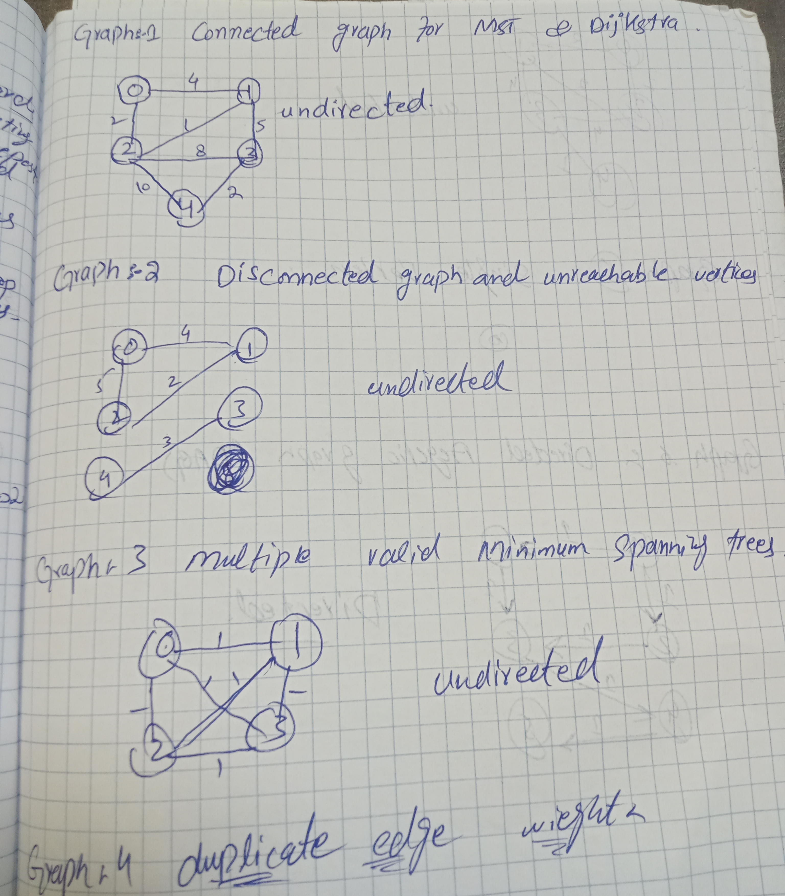
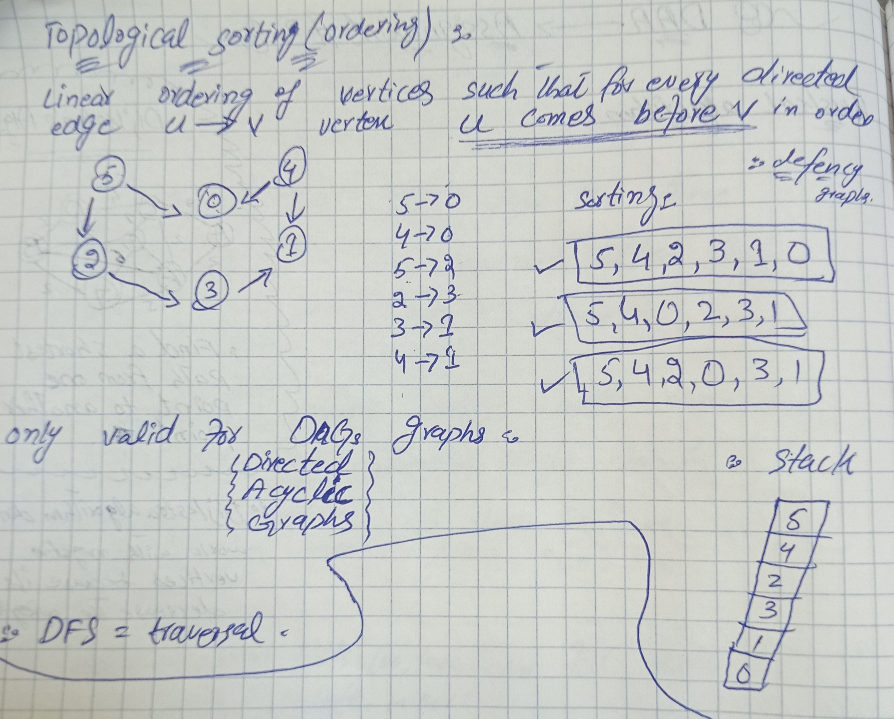
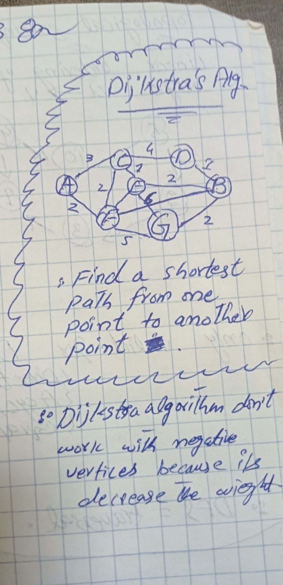
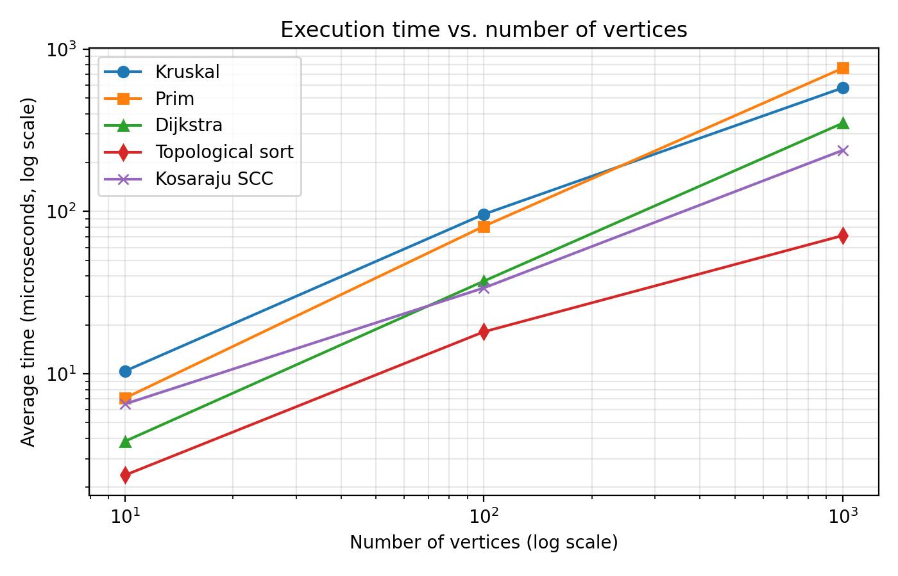
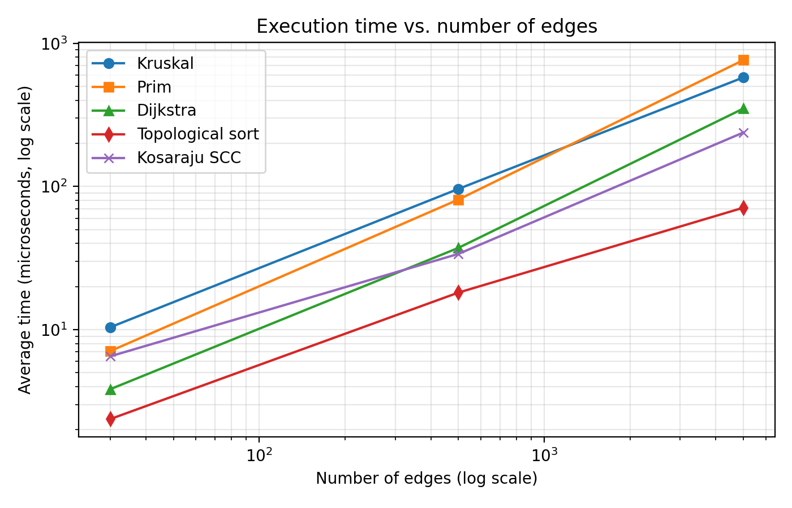
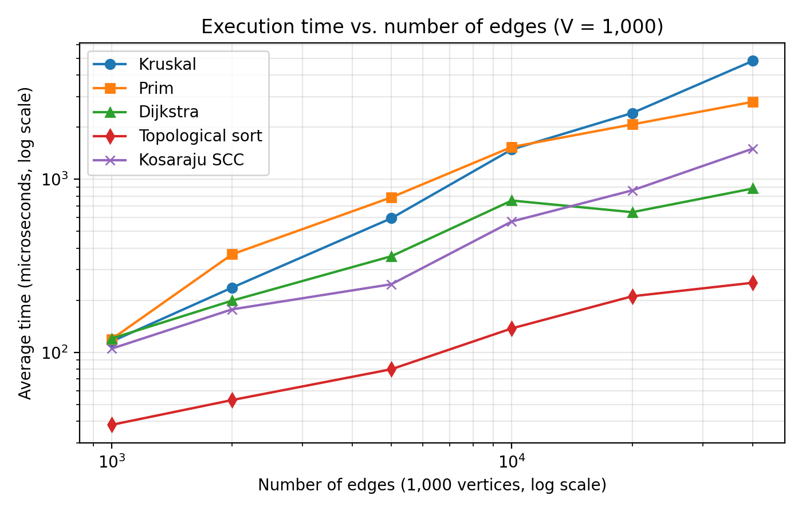
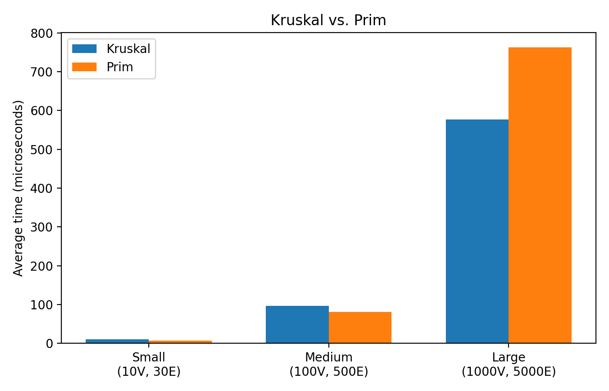

# Assignment 3: Smart City Infrastructure and Route Planning

## 1. Overview
This program represents a city as a graph. Vertices are districts, edges are roads, and weights are road costs or distances.
## Graphs

## 2. Files
- `graph/Edge.java`: stores a road and its weight.
- `graph/Graph.java`: stores vertices and connections.
- `dsu/DSU.java`: helps detect cycles for Kruskal.
- `mst/MSTAlgorithms.java`: contains Kruskal and Prim.
- `connectivity/ConnectivityAlgorithms.java`: contains topological sorting and Kosaraju SCC.
- `shortestpath/Dijkstra.java`: finds shortest paths.
- `Main.java`: runs a small example.

## 3. Algorithm ideas
- **Kruskal:** sorts edges by weight and adds an edge if it does not create a cycle.
- **Prim:** grows one tree by adding the cheapest edge to a new vertex.
- **DSU:** `find` gets a set's representative; `union` joins two sets. Path compression and union by size make operations faster.
- **Topological sorting:** processes vertices with no incoming edges. If not all vertices are processed, there is a cycle.
- **Kosaraju SCC:** uses two depth-first searches to find strongly connected groups.
- **Dijkstra:** repeatedly chooses the closest known vertex and updates distances. It requires non-negative weights because negative edges can make a previously processed distance incorrect.

## 4. Complexity!
- Assumptions: adjacency lists and a binary priority queue.

| Algorithm | Time | Extra space |
|---|---|---|
| DSU `find` / `union` | Amortized O(α(V)) per operation with both optimizations | O(V) |
| Kruskal | O(E log E) | O(V + E) |
| Prim | O((V + E) log V) | O(V + E) |
| Topological sorting | O(V + E) | O(V) |
| Kosaraju SCC | O(V + E) | O(V + E) |
| Dijkstra | O((V + E) log V) | O(V + E) |

## 5. Experimental work

Raw data: `results/tables/results.csv`.

| Size | V | E | Kruskal ops | Prim ops | Dijkstra ops | Kruskal MST weight | Prim MST weight | SCC count |
|---|---|---|---|---|---|---|---|---|
| Small | 10 | 30 | 12 | 12 | 60 | 188 | 188 | 1 |
| Medium | 100 | 500 | 200 | 201 | 1,000 | 1,182 | 1,182 | 2 |
| Large | 1,000 | 5,000 | 3,210 | 3,199 | 10,000 | 12,695 | 12,695 | 16 |

Kruskal and Prim return the same MST weight on all three graphs. Kruskal looked at 12 of 30 edges, 200 of 500 edges and 3,210 of 5,000 edges, because it stops as soon as it has V - 1 tree edges. Dijkstra did exactly 2E relaxations (60, 1,000 and 10,000), since every undirected edge is relaxed from both of its ends.

## Average execution time (microseconds)
Average of 5 runs. Raw data: `results/tables/results.csv`.

| Size | V | E | Kruskal | Prim | Dijkstra | Topological sort | Kosaraju SCC |
|---|---|---|---|---|---|---|---|
| Small | 10 | 30 | 10.4 | 7.1 | 3.8 | 2.4 | 6.5 |
| Medium | 100 | 500 | 96.1 | 81.0 | 37.2 | 18.1 | 33.8 |
| Large | 1,000 | 5,000 | 577.4 | 763.2 | 350.0 | 71.0 | 238.2 |

### 5.4 Plots
Both axes use a log scale because the sizes grow by a factor of 10 each time.

Plot 1: execution time vs. number of vertices.

Plot 2: execution time vs. number of edges.

In the three required sizes the vertices and the edges grow together, so Plots 1 and 2 cannot separate their effects. To see the effect of edges alone, I also kept 1,000 vertices fixed and increased the edges from 1,000 to 40,000 (raw data: `results/tables/edge_sweep.csv`). This is a separate run, so the 5,000-edge row differs slightly from the Large row above.

| V | E | Kruskal ops | Prim ops | Dijkstra ops | Kruskal (us) | Prim (us) | Dijkstra (us) | Topo (us) | Kosaraju (us) |
|---|---|---|---|---|---|---|---|---|---|
| 1,000 | 1,000 | 1,000 | 1,000 | 2,000 | 115.5 | 119.1 | 120.1 | 38.1 | 104.9 |
| 1,000 | 2,000 | 1,983 | 1,988 | 4,000 | 236.5 | 368.3 | 198.8 | 53.0 | 177.1 |
| 1,000 | 5,000 | 3,210 | 3,199 | 10,000 | 595.1 | 785.7 | 359.0 | 79.8 | 247.3 |
| 1,000 | 10,000 | 3,640 | 3,619 | 20,000 | 1487.4 | 1536.7 | 753.3 | 137.4 | 570.2 |
| 1,000 | 20,000 | 5,412 | 5,368 | 40,000 | 2414.0 | 2074.7 | 645.1 | 210.8 | 862.4 |
| 1,000 | 40,000 | 3,724 | 3,660 | 80,000 | 4828.5 | 2801.1 | 884.0 | 252.2 | 1502.0 |

Plot 3: execution time vs. number of edges with 1,000 vertices.

Plot 4: Kruskal and Prim on the three required sizes.

## 6. Testing checklist
All tests are in `Tests.java`. The output is saved in `results/tables/test_output.txt`: 18 checks passed and 0 failed.

- [x] Small graph: Kruskal and Prim both give weight 10, Dijkstra distances are 0, 3, 2, 8, 10
- [x] Disconnected graph: Kruskal and Prim both report that the graph is not connected
- [x] Directed graph with a cycle: topological sorting detects the cycle
- [x] Graph with more than one possible MST: both algorithms give weight 3
- [x] Unreachable vertices: Dijkstra keeps the distance as `Long.MAX_VALUE` and returns an empty path
- [x] Duplicate edge weights: both algorithms give weight 9
- [x] Single vertex: MST weight is 0 and Dijkstra distance is 0
- [x] Kruskal and Prim give the same MST weight on 50 random connected graphs
- [x] Topological sorting returns a valid order for a DAG and detects cycles
- [x] Every vertex belongs to exactly one SCC (the example graph gives 3 components)
- [x] Dijkstra gives correct distances for non-negative weights

## 7. Results and discussion

**How time changes with vertices and edges.** Every algorithm gets slower as the graph grows. From Medium to Large, both vertices and edges grow by 10 times, and the times grew by about 6 times for Kruskal, 9.4 times for Prim, 9.4 times for Dijkstra, 7 times for Kosaraju and 3.9 times for topological sorting. That is close to linear growth, which fits the O(V + E) algorithms and the O(E log E) and O((V + E) log V) algorithms, because the log factor only adds a small amount between these sizes. Growth is smaller than 10 times for some algorithms. One reason is that the Small and Medium timings are only a few microseconds to a few tens of microseconds, so fixed costs such as object creation take a larger share there. For Kruskal, early stopping also reduces the work, since it examined only 64% of the edges on the Large graph.

**Kruskal compared with Prim.** Both build an MST of the same weight, and their operation counts are almost identical (3,210 and 3,199 on the Large graph). Their times are in the same range, but the faster one depends on how dense the graph is. In the 1,000-vertex sweep they were about equal at 1,000 edges, Kruskal was faster at 2,000 and 5,000 edges, they were about equal at 10,000 edges, and Prim was faster at 20,000 and 40,000 edges (2,075 vs 2,414 and 2,801 vs 4,829 microseconds). On the three required sizes, Prim was faster on Small and Medium and Kruskal was faster on Large (577 vs 763 microseconds). So on sparse graphs Kruskal is competitive, and on denser graphs Prim is better, because Kruskal pays for sorting all E edges while Prim only works with the edges next to the tree.

**Do the results match the complexity analysis?** Mostly yes. Kruskal, with its O(E log E) sort, is the algorithm that reacts most to extra edges. Dijkstra, topological sorting and Kosaraju grow slowly and steadily as expected for O(V + E) and O((V + E) log V) algorithms. The Kruskal against Prim comparison also matches the theory that sorting every edge costs more as the graph gets denser.

## 8. Conclusion
All five algorithms produced correct results on every test in the checklist, and Kruskal and Prim returned the same MST weight on every connected graph tested. In the experiments, running time grew roughly in proportion to the graph size, which matches the complexity analysis. Topological sorting and Kosaraju were cheapest, Dijkstra was in the middle, and the two MST algorithms were the most expensive on the Large graph. Kruskal slows down most when the graph gets denser, because it sorts every edge, while Prim handled the dense graphs better. For a sparse city road network, either MST algorithm is a good choice, and Prim becomes the better choice when many extra roads are added.
